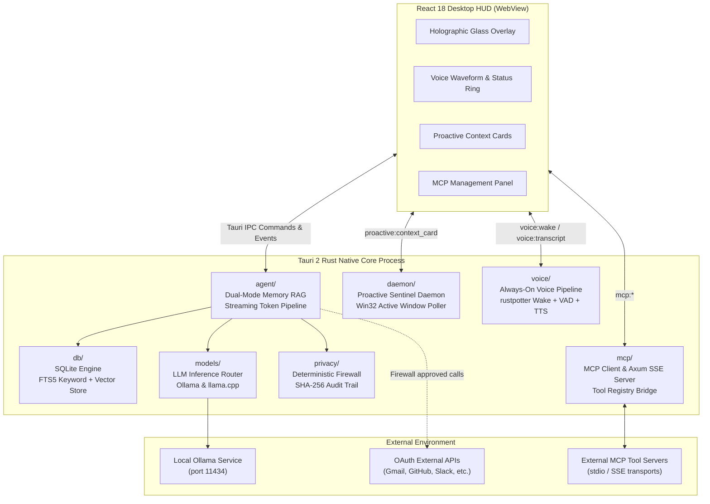
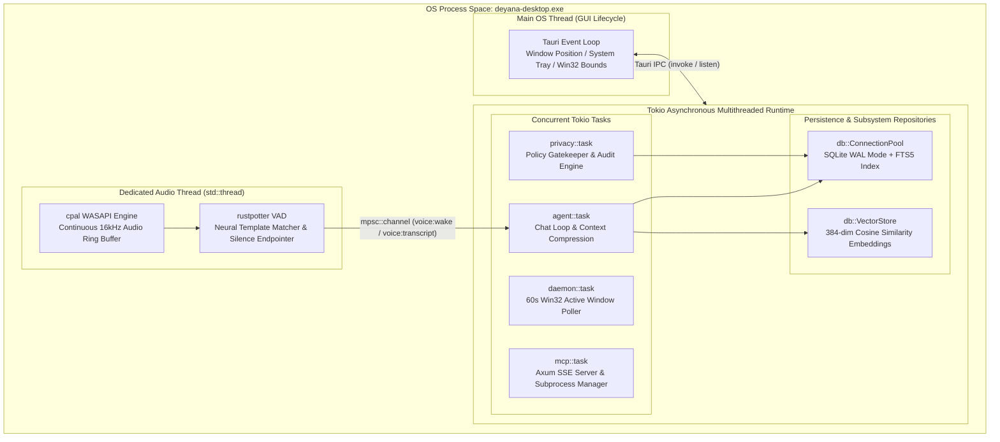

# DEYANA System Architecture Specification

This document details the system design, subsystem contracts, memory boundaries, and execution models of **Deyana** — a privacy-enforced, local-first desktop AI assistant built in native Rust (Tauri 2) with a React 18 frontend.

---

## 1. Executive Architectural Overview

Deyana is designed to serve as an on-device personal and workspace assistant operating over sensitive user context (local codebases, personal notes, chat history, and active window states).

### Non-Negotiable System Invariants

1. **Zero External AI Egress:** Private context (files, chat history, vector embeddings, vault notes, voice transcripts, and active window titles) must never be transmitted to cloud AI services or external LLM APIs.
2. **Single-Binary Process Lifecycle:** All business logic, state management, retrieval indexing, background daemons, and protocol handlers reside in a single compiled Rust binary (`apps/desktop/src-tauri`). There are no Python runtimes, Node.js background services, or loopback HTTP servers for internal communication.
3. **Hardware-Aware Execution:** System subsystems auto-profile host hardware, maintaining a sub-100MB idle RAM footprint and ensuring low CPU overhead on dual-core low-spec Windows devices.
4. **Deterministic Policy Enforcement:** Network calls to external APIs pass through a pre-execution privacy policy evaluator with cryptographic SHA-256 audit logging.

### High-Level System Architecture

---

## 2. Process Topology & Concurrency Model

Deyana uses an event-driven asynchronous execution model built on top of Tokio and the Tauri 2 process architecture.

### Threading & Subsystem Isolation

- **Main UI Thread:** Owns the OS window lifecycle, system tray integration, and native Win32 window positioning.
- **Tokio Asynchronous Runtime:** Handles concurrent task execution including agent chat loops, MCP server requests, SQLite transactions, and connector synchronization runs.
- **Dedicated Audio Thread:** Isolates continuous microphone capture (`cpal` WASAPI backend) on a dedicated native OS thread to prevent audio buffer underruns during heavy LLM inference.

---

## 3. Subsystem Specifications

### 3.1 Agent Brain & Retrieval Pipeline (`agent/`, `db/`)

The agent brain orchestrates conversation state and memory retrieval.

- **Hybrid Dual-Mode RAG:**
  - **Lexical Search:** SQLite FTS5 index performing BM25 keyword scoring over structured memory items and Markdown vault notes.
  - **Dense Vector Search:** Generates 384-dimensional embeddings via local Ollama models (`all-minilm`) stored in SQLite, executed using cosine similarity scoring.
  - **Rank Fusion:** Combines lexical and vector candidate sets to construct the optimal context payload.
- **Context Window Management:** Performs sliding-window context compression, budgeting tokens based on active LLM profile limits (e.g. 2,048 tokens on low-spec hardware up to 16,384 tokens on Ultra profiles).
- **Streaming Pipeline:** Streams generation tokens asynchronously back to the React HUD using `tauri::Emitter` on the `llm:stream_chunk` channel.

### 3.2 Proactive Sentinel Daemon (`daemon/`)

The sentinel daemon operates as an autonomous background observer monitoring user desktop state.

- **Win32 Window Focus Poller:** Queries `GetForegroundWindow` and `GetWindowTextW` every 60 seconds to track active applications and workspace context.
- **Context Synthesis:** Cross-references active window titles with upcoming calendar events and unread triage items.
- **Card Dispatch:** Emits non-intrusive `proactive:context_card` events to the UI HUD containing actionable suggestions with priority scoping (`normal`, `urgent`).

### 3.3 Audio & Voice Subsystem (`voice/`)

Provides continuous hands-free voice interaction.

- **Wake Word Engine:** Runs `rustpotter` neural template matching over a continuous 16kHz audio input ring buffer managed by `cpal` (WASAPI backend).
- **Speech End-Pointer:** Implements energy-based Voice Activity Detection (VAD) with a configurable 1.5-second silence threshold.
- **Native Speech Synthesis:** Utilizes the OS-native Windows Speech API (via the `tts` crate) for zero-latency local speech playback without external model dependencies.

### 3.4 MCP Runtime Architecture (`mcp/`)

Deyana implements a full Model Context Protocol (MCP) environment in dual client/server configuration.

- **MCP Client Manager:**
  - Subprocess supervisor for external MCP tool servers (stdio and SSE transports).
  - Compatible with standard `claude_desktop_config.json` configuration formats.
  - Dynamically registers external MCP tool definitions into Deyana's unified tool registry.
- **MCP Local Server:**
  - Hosts a local Axum SSE endpoint exposing memory query tools (`search_deyana_memory`, `read_vault_note`, `create_vault_note`).
  - Allows authorized external IDE plugins (Claude Desktop, Cursor, Antigravity) to query Deyana's memory without data leaving the machine.

### 3.5 Privacy Firewall & Cryptographic Audit (`privacy/`)

All external network operations are intercepted by the deterministic privacy firewall.

- **Policy Classification:** Outbound requests are evaluated against destination domains, payload data categories, and user permission states.
- **Deterministic Egress Gatekeeping:** Private user data is strictly blocked from external transmission.
- **Cryptographic Audit Logger:** Every firewall decision (allowed or blocked) generates an append-only log record in SQLite featuring a SHA-256 hash of the request payload and evaluation metadata.

---

## 4. Data Persistence & Vault Storage

### 4.1 SQLite Database Schema (`db/`)

The primary relational data store operates in SQLite WAL (Write-Ahead Logging) mode for concurrent read-write performance.

| Table Name | Primary Indices | Purpose |
|---|---|---|
| `memory_items` | `id`, `category`, `created_at` | Structured memory entries |
| `memory_fts` | FTS5 Index (`title`, `content`) | Full-text search virtual table |
| `memory_embeddings` | `memory_id` | Vector embedding storage for cosine similarity |
| `chat_messages` | `session_id`, `created_at` | Session-scoped chat message logs |
| `audit_logs` | `id`, `timestamp`, `hash` | Append-only SHA-256 privacy audit logs |
| `connector_sync_runs` | `connector_id`, `status` | Sync history and record statistics |

### 4.2 Local Markdown Vault Mirroring

Memory entries and connector summaries are bi-directionally synchronized to a local Markdown vault directory chosen by the user. Files are stored as plain UTF-8 Markdown (`.md`) with YAML frontmatter metadata, remaining fully accessible and editable outside of Deyana.

---

## 5. IPC Interface Specification

### Core Tauri Commands

| Command Signature | Subsystem | Return Type | Description |
|---|---|---|---|
| `agent_chat(prompt, session_id)` | agent | `Result<ChatMessageResponse, String>` | Initiates agent execution loop and streams response tokens |
| `get_agent_status()` | agent | `Result<AgentStatusResponse, String>` | Returns active model, persona state, and memory status |
| `evaluate_privacy_policy(target, category)` | privacy | `Result<PrivacyEvaluation, String>` | Evaluates outbound request parameters against active policy |
| `get_privacy_audit_logs(limit)` | privacy | `Result<Vec<AuditLogEntry>, String>` | Fetches append-only SHA-256 privacy audit records |
| `start_wake_listener()` | voice | `Result<(), String>` | Activates continuous background audio capture and wake detection |
| `transcribe_audio(buffer)` | voice | `Result<String, String>` | Converts recorded PCM audio buffer to text via local STT |
| `speak_text(text)` | voice | `Result<(), String>` | Synthesizes local audio output via native Windows TTS |
| `mcp_connect_server(name, config)` | mcp | `Result<McpServerStatus, String>` | Launches and handshakes with an external MCP tool server |
| `mcp_call_tool(server_id, tool_name, args)` | mcp | `Result<McpToolResponse, String>` | Executes a tool on a connected MCP server |
| `sync_connector(connector_id)` | connectors | `Result<SyncRunSummary, String>` | Triggers an incremental fetch cycle for an authorized connector |

### Tauri Event Subscriptions

| Event Channel | Payload Type | Dispatch Frequency | Subsystem Origin |
|---|---|---|---|
| `llm:stream_chunk` | `String` (Token Chunk) | Real-time during inference | `agent::commands` |
| `proactive:context_card` | `ProactiveContextCard` | On 60s context shift | `daemon::mod` |
| `voice:wake` | `WakeEventData` | On "Deyana" wake word match | `voice::detector` |
| `voice:transcript` | `TranscriptionResult` | On speech VAD end-point | `voice::service` |
| `core:status` | `CoreStatusData` | On subsystem state change | `main::process` |
