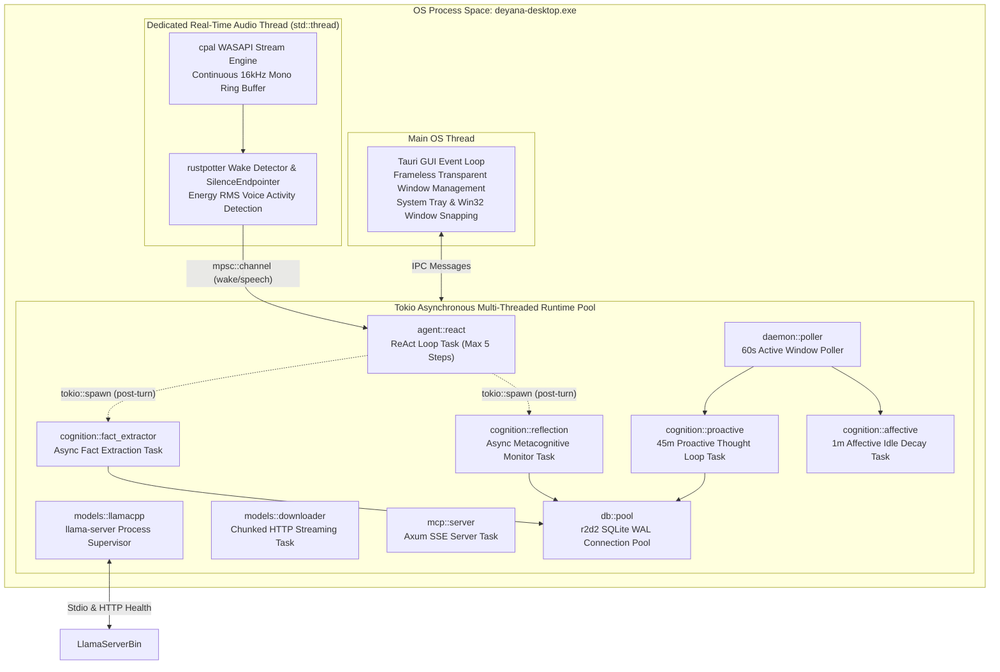
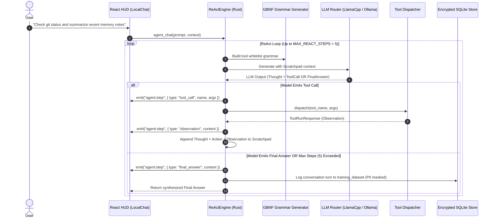
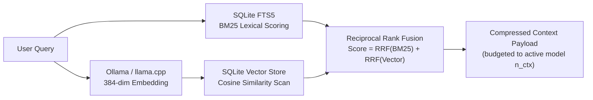
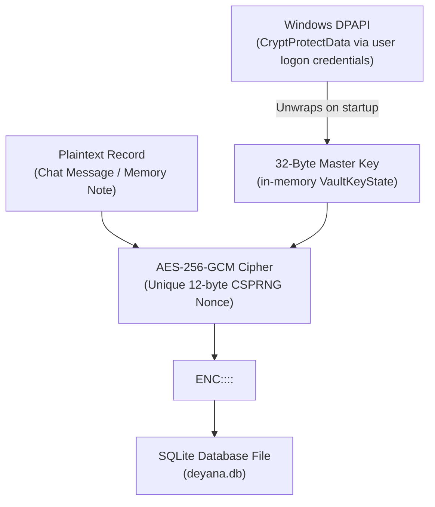
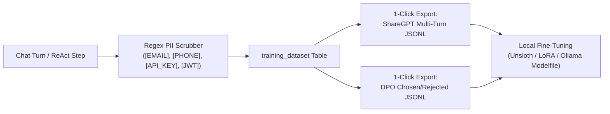
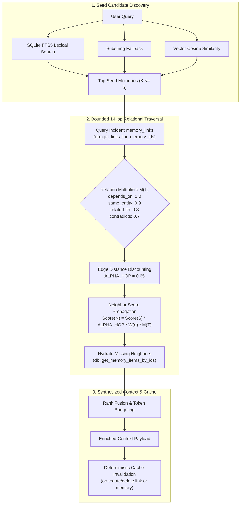
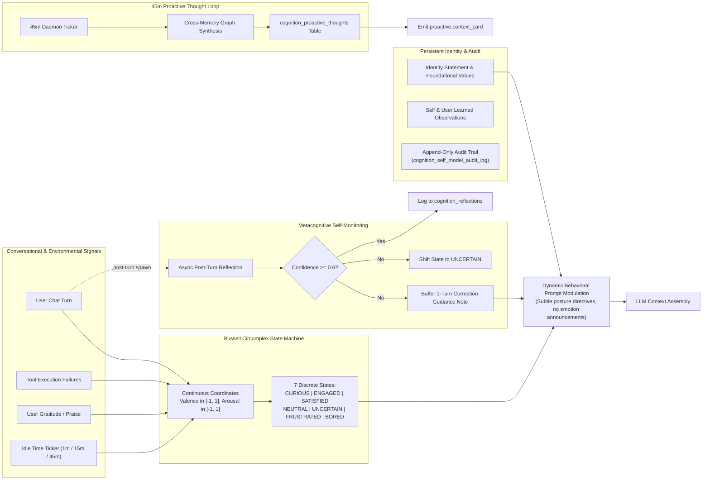
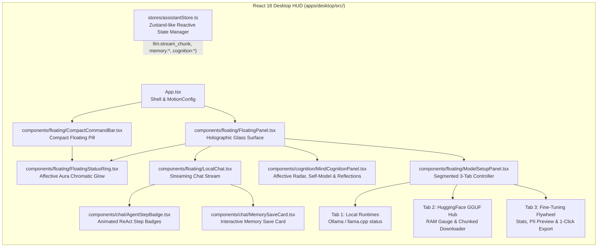

# DEYANA System Architecture Specification (v2.0 Full-Stack AI Edition)

This doc provides the definitive architectural specification, subsystem contracts, mathematical execution models, and data security boundaries of **Deyana** — an on-device, privacy-enforced, local-first personal and workspace AI assistant.

Deyana is implemented as a single compiled native Rust binary (`apps/desktop/src-tauri`) with a high-performance React 18 / TypeScript floating holographic HUD.

---

## 1. Executive Architectural Overview

Deyana operates directly over sensitive user context — local source code repositories, personal markdown notes, encrypted chat transcripts, active desktop window focus states, and authorized workplace connectors (Gmail, GitHub, Slack, Notion, Jira, Linear) — without transmitting private data to cloud AI services.

### 1.1 Non-Negotiable System Invariants

1. **Zero External AI Egress:** Private context (files, chat history, vector embeddings, vault notes, voice transcripts, and active window titles) is strictly blocked from external cloud AI APIs.
2. **Single-Binary Process Lifecycle:** All business logic, state management, retrieval indexing, background daemons, and protocol handlers reside in a single compiled Rust binary (`deyana-desktop.exe`). There are no Python runtimes, Node.js background services, or loopback HTTP servers for internal communication.
3. **Hardware-Aware Execution:** Subsystems automatically detect host hardware capabilities, maintaining a sub-100MB idle RAM footprint and adapting context windows from 2,048 tokens on low-spec laptops up to 128,000 tokens on multi-GPU workstations.
4. **Hardware-Backed Encryption:** All sensitive database records (chat history, personal notes, semantic cache) are encrypted at rest using AES-256-GCM with keys protected by the OS (Windows DPAPI).
5. **Continuous Fine-Tuning Flywheel:** High-quality local interactions are automatically logged with regex PII masking and can be exported with 1 click into ShareGPT or DPO preference JSONL for local model training.

### 1.2 High-Level System Architecture

```mermaid
flowchart TD
    subgraph UI["React 18 Desktop HUD (WebView2 Shell)"]
        HUD["Holographic Glass Floating Panel<br/>(Framer Motion + TailwindCSS)"]
        ChatUI["LocalChat & Expandable Scratchpad<br/>(AgentStepBadge.tsx)"]
        SaveCardUI["MemorySaveCard Review Cards<br/>(Inline Fact Approval & Edit)"]
        MindUI["Mind & Cognition Panel<br/>(Affective Radar, Self-Model, Reflections)"]
        ModelUI["Unified ModelSetupPanel<br/>(Runtimes | GGUF Hub | Flywheel)"]
        VoiceViz["Voice Waveform & Status Ring<br/>(Ambient Affective Aura Glow)"]
        ProactiveUI["Proactive Context Cards"]
    end

    subgraph Rust["Tauri 2 Rust Native Core Process (deyana-desktop.exe)"]
        ReAct["agent::react<br/>Autonomous ReAct Engine<br/>(Thought ➔ Action ➔ Observation)"]
        Prompt["agent::prompt<br/>Dynamic System Prompt Assembler<br/>(Behavioral Postures & Self-Model)"]
        Grammar["agent::grammar<br/>GBNF Grammar Engine<br/>Token-Level Tool Constraints"]
        Dispatcher["agent::dispatcher<br/>Native Tool Dispatcher<br/>(Memory, Git, Web, Notes)"]
        Retrieval["agent::retrieval<br/>Relational Graph Walker<br/>FTS5 + Vector + 1-Hop Traversal"]
        Cache["agent::cache<br/>Semantic LRU Cache<br/>Embedding + Context Hash"]
        
        Cognition["cognition/<br/>The Mind Layer<br/>Russell Affective State Machine<br/>Persistent Self-Model & Audit Log"]
        FactExtract["cognition::fact_extractor<br/>Async Turn Fact Extraction<br/>Triage & Staged Suggestions"]
        Reflection["cognition::reflection<br/>Metacognitive Monitor<br/>Confidence Scoring & Low-Conf Buffer"]
        Proactive["cognition::proactive<br/>45m Proactive Thought Loop<br/>Cross-Memory Synthesis"]
        
        LlamaCpp["models::llamacpp<br/>Managed llama-server Supervisor<br/>(SSE Streaming & Subprocess Control)"]
        Ollama["models::ollama<br/>Ollama Native Client<br/>(Port 11434 HTTP Bridge)"]
        Downloader["models::downloader<br/>HuggingFace GGUF Downloader<br/>RAM Estimator & Streamer"]
        Flywheel["models::dataset<br/>Continuous Fine-Tuning Flywheel<br/>PII Masker & JSONL Exporter"]
        Hardware["models::hardware<br/>Hardware Auto-Detector<br/>4-Tier Profile Mapper (sysinfo)"]
        
        Privacy["privacy::firewall<br/>Deterministic Firewall<br/>SHA-256 Audit Trail"]
        Crypto["privacy::crypto & vault_key<br/>Windows DPAPI + AES-256-GCM<br/>Field-Level Encryption"]
        
        DB["db/<br/>SQLite WAL Mode Engine<br/>Memory Links, Self-Model & Audit"]
        Daemon["daemon/<br/>Proactive Sentinel Daemon<br/>Win32 Poller & 45m Thought Ticker"]
        Voice["voice/<br/>Always-On Voice Pipeline<br/>rustpotter Wake + VAD + Windows TTS"]
        MCP["mcp/<br/>Dual MCP Client & Axum Server<br/>Tool Registry Bridge"]
    end

    subgraph HostEnv["Host Operating System & Services"]
        LlamaServerBin["llama-server.exe<br/>(Spawned Subprocess)"]
        OllamaService["Ollama Service<br/>(System Background Service)"]
        Win32API["Windows APIs<br/>(DPAPI, Win32 Window, SAPI TTS)"]
        McpServers["External MCP Servers<br/>(stdio / SSE transports)"]
        Connectors["OAuth External APIs<br/>(Gmail, GitHub, etc.)"]
    end

    UI <-->|"Tauri IPC (Commands & Events)"| ReAct
    UI <-->|"Tauri IPC (Mind & Memory Graph)"| Cognition
    UI <-->|"Tauri IPC (model management & flywheel)"| ModelUI
    
    ReAct --> Prompt
    Cognition -->|"Behavioral Directives & Values"| Prompt
    Reflection -->|"Buffered Correction Notes"| Prompt
    Prompt --> ReAct
    
    ReAct --> Grammar
    ReAct --> Dispatcher
    ReAct --> Retrieval
    ReAct --> Cache
    ReAct --> LlamaCpp
    ReAct --> Ollama
    
    ReAct -.->|"tokio::spawn (post-turn)"| FactExtract
    ReAct -.->|"tokio::spawn (post-turn)"| Reflection
    FactExtract --> DB
    Reflection --> Cognition
    Daemon --> Proactive
    Proactive --> DB
    
    LlamaCpp <-->|"HTTP / SSE"| LlamaServerBin
    Ollama <-->|"HTTP API"| OllamaService
    Downloader -->|"HTTPS (HuggingFace Hub)"| Privacy
    
    Flywheel --> DB
    Retrieval --> DB
    Crypto <-->|"CryptProtectData / CryptUnprotectData"| Win32API
    DB --> Crypto
    
    Voice <-->|"WASAPI / SAPI"| Win32API
    Daemon <-->|"GetForegroundWindow"| Win32API
    MCP <--> McpServers
    Dispatcher -.->|"Approved Calls"| Connectors
```



---

## 2. Process Topology & Concurrency Model

Deyana utilizes a multi-threaded, asynchronous runtime architecture powered by Tokio and Tauri 2:



### Threading & Subsystem Isolation Guarantees
- **UI Responsiveness:** Heavy LLM inference, embedding generation, and GGUF downloads never block the main GUI thread.
- **Audio Protection:** Microphone sampling and neural wake word detection execute on a dedicated native OS thread (`std::thread`), completely insulated from Tokio runtime task preemption.
- **Database Concurrency:** SQLite operates in Write-Ahead Logging (`PRAGMA journal_mode=WAL;`) with an `r2d2` thread pool, allowing concurrent readers alongside writes.
- **Zero-Latency Post-Turn Decoupling:** Long-term conversation fact extraction and metacognitive self-reflection passes execute asynchronously via `tokio::spawn` after the turn response is finalized and streamed, preventing any user-perceived token latency.
- **Cognitive Daemon Isolation:** Affective idle decay (1-minute ticker) and proactive cross-memory synthesis (45-minute ticker) run on detached background daemon timers, ensuring zero interference with interactive chat queries.

---

## 3. Subsystem Specifications

### 3.1 Autonomous Multi-Turn ReAct Agent Engine (`agent/react.rs`)

Deyana features a full **Reasoning + Acting (ReAct)** autonomous agent engine that enables iterative problem solving:



#### ReAct Execution Invariants
- **Step Bound:** Hard-capped at `MAX_REACT_STEPS = 5` to prevent infinite execution loops.
- **Grammar-Constrained Schema:** The GBNF engine ensures that tool calls strictly adhere to the schema:
  ```json
  {"thought": "reasoning...", "tool_call": {"name": "tool_name", "arguments": {}}}
  ```
- **Robust Recovery:** If the LLM generates malformed JSON or invokes an invalid tool, the engine synthesizes an error observation (e.g. `"Tool 'xyz' not found. Available: [...]"`) and feeds it back to the model for self-correction.

---

### 3.2 Dual-Mode Memory & Context Engineering (`agent/retrieval.rs`, `agent/cache.rs`, `db/`)

Memory retrieval balances speed and semantic depth through hybrid rank fusion:



#### Mathematical Retrieval Models
1. **Vector Cosine Similarity:**
   $$\text{sim}(\mathbf{u}, \mathbf{v}) = \frac{\mathbf{u} \cdot \mathbf{v}}{\|\mathbf{u}\|_2 \|\mathbf{v}\|_2} = \frac{\sum_{i=1}^d u_i v_i}{\sqrt{\sum_{i=1}^d u_i^2} \sqrt{\sum_{i=1}^d v_i^2}}$$
2. **Semantic Cache Lookup:**
   In-memory LRU + SQLite cache keyed by query vector and context hash. If cosine distance $\ge 0.96$, the cached answer returns with zero LLM inference latency.

---

### 3.3 Inference Engine & Hardware Auto-Detection (`models/`)

Deyana supports dual inference runtimes:
1. **Managed llama.cpp Engine (`models/llamacpp.rs`):** Launches and monitors `llama-server.exe` as a supervised child process with real-time SSE streaming.
2. **Ollama Client (`models/ollama.rs`):** HTTP connection to local Ollama on port `11434`.

#### Hardware Auto-Detection Profiles (`models/hardware.rs`)
Host RAM is probed via `sysinfo` on startup and mapped to four operational profiles:

| Profile | RAM Threshold | Recommended Models | Max Context Window | Quantization |
|---|---|---|---|---|
| **Balanced** | 8 – 16 GB | `qwen3:1.7b`, `llama3.2:3b` | 4,096 tokens | `Q4_K_M` |
| **Standard** | 16 – 32 GB | `llama3.3:8b`, `qwen2.5-coder:7b` | 8,192 tokens | `Q4_K_M` / `Q5_K_M` |
| **Power** | 32 – 64 GB | `qwen2.5:14b`, `deepseek-r1:14b` | 16,384 tokens | `Q5_K_M` / `Q8_0` |
| **Ultra** | 64+ GB / Multi-GPU | `qwen2.5:32b`, `llama3.3:70b` | 32,768 – 128,000 tokens | `Q4_K_M` / `Q8_0` |

#### KV-Cache & Host RAM Estimation Formula (`models/downloader.rs`)
Before downloading GGUF files from HuggingFace Hub, Deyana calculates the exact memory required to run the model safely:

$$\text{RAM}_{\text{req}} = \text{Model Weight Size (Bytes)} + \text{KV Cache Size} \times 1.25$$

Where the KV-Cache memory is computed as:
$$\text{KV Cache Size} = 2 \times n_{\text{layers}} \times n_{\text{heads}} \times d_{\text{head}} \times n_{\text{ctx}} \times \text{bytes per element}$$

---

### 3.4 Hardware-Backed Cryptographic Security (`privacy/`)

To protect user confidentiality against physical disk theft and unauthorized local process inspection:



#### Cryptographic Specifications
- **Master Key Security:** Wrapped via Windows Data Protection API (DPAPI) and persisted to disk. Unwrapping requires the active user's Windows logon session.
- **Cipher:** AES-256-GCM with a fresh, cryptographically secure random 12-byte nonce per encryption operation.
- **Envelope Format:** `ENC::<12_BYTE_HEX_NONCE>::<CIPHERTEXT_AND_TAG_HEX>`. Unencrypted legacy records pass through seamlessly during migration.

---

### 3.5 Continuous Fine-Tuning Flywheel (`models/dataset.rs`)

Deyana includes a built-in data flywheel that logs interactions to create custom fine-tuning datasets:



#### Supported Dataset Formats
1. **ShareGPT Format:** Multi-turn conversational JSONL (`conversations: [{from: "human", value: ...}, {from: "gpt", value: ...}]`).
2. **DPO / ORPO Format:** Direct Preference Optimization pairs (`prompt`, `chosen`, `rejected`) using user-edited responses as chosen targets.

---

### 3.6 Memory Graph Intelligence & Relational Graph Walker (`db/`, `agent/retrieval.rs`, `cognition/fact_extractor.rs`)

Phase 33 transitions Deyana's episodic and semantic memory from flat lexical/vector similarity searches into a typed, weighted directional knowledge graph stored in SQLite:



#### Relational Traversal & Scoring Formulation
Let $S$ be a seed memory item with base hybrid relevance score $\text{Score}(S) \in [0, 1]$. For each directional link $e = (S, N)$ or $(N, S)$ connecting $S$ to neighbor node $N$, the propagated relevance score is computed as:

$$\text{Score}(N) = \text{Score}(S) \times \alpha_{\text{hop}} \times W(e) \times M(T)$$

Where:
- $\alpha_{\text{hop}} = 0.65$ represents the single-hop attenuation factor.
- $W(e) \in [0.0, 1.0]$ is the normalized edge weight stored in `memory_links`.
- $M(T)$ is the relation-type relevance multiplier:
  $$M(T) = \begin{cases} 
  1.0 & \text{if } T = \text{depends\_on} \\
  0.9 & \text{if } T = \text{same\_entity} \\
  0.8 & \text{if } T = \text{related\_to} \\
  0.7 & \text{if } T = \text{contradicts} 
  \end{cases}$$

#### Asynchronous Fact Extraction Pipeline
1. **Post-Turn Spawning:** After emitting `"agent:done"`, `execute_agent_chat` spawns `FactExtractor::process_turn_async` on Tokio's task pool.
2. **Heuristic Pre-Filtering:** Ignores conversational pleasantries, short messages (< 12 characters), and system greetings.
3. **Structured Fact Triage:**
   - **High Importance (4–5):** Essential project facts, configuration values, or explicit user directives are auto-committed to `memory_items`, automatically invalidating `semantic_cache` and emitting `"memory:fact_auto_committed"`.
   - **Medium Importance (3):** Contextual facts and preferences are staged in `memory_save_suggestions` with status `'pending'`, emitting `"memory:save_card"` for desktop review.
   - **Low Importance (1–2):** Ephemeral conversational details are dropped without disk writes.

---

### 3.7 Cognitive Architecture & The Mind Layer (`cognition/`)

Deyana's cognitive layer implements dynamic internal state reflection, emotional continuity, self-correction, and proactive synthesis:



#### Mathematical Affective State Model
Emotional presence is formalized on the continuous Russell Circumplex plane $(V, A) \in [-1.0, 1.0]^2$, mapped to seven discrete centroid attractor states:

$$\mathbf{p}_{\text{state}} = (V, A)$$

| Discrete State | Valence ($V$) | Arousal ($A$) | Operational Behavioral Posture |
|---|---|---|---|
| `CURIOUS` | $+0.6$ | $+0.7$ | High exploratory depth, probing questions, proactive knowledge linking |
| `ENGAGED` | $+0.7$ | $+0.5$ | Maximum collaborative momentum, concise structure, rapid execution |
| `SATISFIED` | $+0.8$ | $-0.2$ | Calm affirmation, thorough synthesis, polished deliverable delivery |
| `NEUTRAL` | $0.0$ | $0.0$ | Balanced, objective, minimal stylistic coloration |
| `UNCERTAIN` | $-0.3$ | $+0.4$ | Clear delineation between verified vs provisional facts, conservative assumptions |
| `FRUSTRATED` | $-0.7$ | $+0.6$ | Diagnostic focus, explicit root-cause error analysis, fail-safe fallbacks |
| `BORED` | $-0.4$ | $-0.6$ | Minimal conversational fluff, low energy until stimulated by complex prompt |

#### Idle Decay Kinetics
In the absence of conversational signals, the state vector decays toward baseline equilibria:
$$\mathbf{p}(t + \Delta t) = \mathbf{p}(t) + \lambda (\mathbf{p}_{\text{target}} - \mathbf{p}(t)) \Delta t$$
Where:
- For $t \in [15\text{ min}, 45\text{ min}]$, $\mathbf{p}_{\text{target}} = \mathbf{p}_{\text{NEUTRAL}} = (0.0, 0.0)$ with decay half-life $\tau_{1/2} = 5\text{ min}$.
- For $t > 45\text{ min}$, $\mathbf{p}_{\text{target}} = \mathbf{p}_{\text{BORED}} = (-0.4, -0.6)$.

#### Metacognitive Confidence Buffer Delivery
When post-response reflection scores turn confidence $C_{\text{turn}} < 0.6$:
1. A single-turn corrective directive is staged in `CognitionState.pending_correction`.
2. On the immediate subsequent turn, `execute_agent_chat` atomically takes the note (`.take()`), embedding it in `build_system_prompt`.
3. The note is consumed and cleared from memory, guaranteeing that prompt correction notes do not accumulate across turns.

---

## 4. Desktop Frontend Architecture

The user interface is a frameless, holographic floating overlay built in React 18, TailwindCSS, and Framer Motion:



---

## 5. Data Persistence & SQLite WAL Schema

Primary relational storage is managed by SQLite in WAL mode:

```sql
-- Memory Items (AES-256-GCM encrypted content)
CREATE TABLE memory_items (
    id TEXT PRIMARY KEY,
    title TEXT NOT NULL,
    category TEXT NOT NULL,
    content_markdown TEXT NOT NULL,  -- ENC::<nonce>::<ciphertext>
    tags_json TEXT NOT NULL DEFAULT '[]',
    created_at TEXT NOT NULL,
    updated_at TEXT NOT NULL
);

-- Full-Text Search Virtual Table (FTS5)
CREATE VIRTUAL TABLE memory_fts USING fts5(
    title,
    content,
    content='memory_items',
    content_rowid='rowid'
);

-- Vector Embeddings for Cosine Similarity
CREATE TABLE memory_embeddings (
    memory_id TEXT PRIMARY KEY,
    embedding_json TEXT NOT NULL,
    model TEXT NOT NULL,
    created_at TEXT NOT NULL,
    FOREIGN KEY(memory_id) REFERENCES memory_items(id) ON DELETE CASCADE
);

-- Encrypted Chat History
CREATE TABLE chat_messages (
    id TEXT PRIMARY KEY,
    session_id TEXT,
    role TEXT NOT NULL,
    content TEXT NOT NULL,           -- ENC::<nonce>::<ciphertext>
    metadata_json TEXT,
    created_at TEXT NOT NULL
);

-- Continuous Fine-Tuning Dataset
CREATE TABLE training_dataset (
    id TEXT PRIMARY KEY,
    instruction TEXT NOT NULL,
    input_context TEXT NOT NULL,
    output TEXT NOT NULL,
    user_edit TEXT,
    quality_score REAL DEFAULT 1.0,
    created_at TEXT NOT NULL
);

-- Encrypted OAuth Connector Tokens
CREATE TABLE connector_tokens (
    connector_id TEXT PRIMARY KEY,
    encrypted_token TEXT NOT NULL,
    nonce TEXT NOT NULL,
    updated_at TEXT NOT NULL
);

-- Semantic Cache Entries (Encrypted)
CREATE TABLE semantic_cache (
    id TEXT PRIMARY KEY,
    query_hash TEXT NOT NULL,
    embedding_json TEXT NOT NULL,
    response_content TEXT NOT NULL,  -- ENC::<nonce>::<ciphertext>
    created_at TEXT NOT NULL
);

-- Relational Memory Knowledge Graph Links
CREATE TABLE memory_links (
    id TEXT PRIMARY KEY,
    source_id TEXT NOT NULL,
    target_id TEXT NOT NULL,
    relation_type TEXT NOT NULL CHECK (relation_type IN ('related_to', 'depends_on', 'contradicts', 'same_entity')),
    weight REAL NOT NULL DEFAULT 1.0 CHECK (weight >= 0.0 AND weight <= 1.0),
    metadata_json TEXT NOT NULL DEFAULT '{}',
    created_at TEXT NOT NULL,
    updated_at TEXT NOT NULL,
    CHECK (source_id != target_id),
    UNIQUE (source_id, target_id, relation_type),
    FOREIGN KEY (source_id) REFERENCES memory_items(id) ON DELETE CASCADE,
    FOREIGN KEY (target_id) REFERENCES memory_items(id) ON DELETE CASCADE
);

-- Staged Conversation Fact Extraction Suggestions
CREATE TABLE memory_save_suggestions (
    id TEXT PRIMARY KEY,
    session_id TEXT,
    fact_text TEXT NOT NULL,
    entities_json TEXT NOT NULL DEFAULT '[]',
    category TEXT NOT NULL,
    importance INTEGER NOT NULL DEFAULT 3,
    rationale TEXT NOT NULL,
    status TEXT NOT NULL DEFAULT 'pending' CHECK (status IN ('pending', 'approved', 'dismissed', 'auto_committed')),
    created_memory_id TEXT,
    created_at TEXT NOT NULL,
    resolved_at TEXT,
    FOREIGN KEY (created_memory_id) REFERENCES memory_items(id) ON DELETE SET NULL
);

-- Persistent Identity Self-Model
CREATE TABLE cognition_self_model (
    id TEXT PRIMARY KEY,
    identity_statement TEXT NOT NULL,
    core_values_json TEXT NOT NULL DEFAULT '[]',
    intellectual_interests_json TEXT NOT NULL DEFAULT '[]',
    self_observations_json TEXT NOT NULL DEFAULT '[]',
    user_observations_json TEXT NOT NULL DEFAULT '[]',
    version INTEGER NOT NULL DEFAULT 1,
    created_at TEXT NOT NULL,
    updated_at TEXT NOT NULL
);

-- Append-Only Self-Model Modification Audit Log
CREATE TABLE cognition_self_model_audit_log (
    id TEXT PRIMARY KEY,
    version INTEGER NOT NULL,
    field_changed TEXT NOT NULL,
    operation TEXT NOT NULL,
    old_value_json TEXT,
    new_value_json TEXT NOT NULL,
    rationale TEXT NOT NULL,
    triggered_by TEXT NOT NULL,
    created_at TEXT NOT NULL
);

-- Post-Turn Metacognitive Reflections
CREATE TABLE cognition_reflections (
    id TEXT PRIMARY KEY,
    session_id TEXT,
    turn_prompt TEXT NOT NULL,
    turn_response TEXT NOT NULL,
    accuracy_score REAL NOT NULL,
    completeness_score REAL NOT NULL,
    confidence_score REAL NOT NULL,
    missed_opportunities TEXT NOT NULL DEFAULT '',
    correction_guidance TEXT NOT NULL DEFAULT '',
    flagged_for_correction INTEGER NOT NULL DEFAULT 0,
    created_at TEXT NOT NULL
);

-- Proactive Thought Loop Cross-Memory Insights
CREATE TABLE cognition_proactive_thoughts (
    id TEXT PRIMARY KEY,
    trigger_reason TEXT NOT NULL,
    thought_summary TEXT NOT NULL,
    hypotheses_json TEXT NOT NULL DEFAULT '[]',
    source_memory_ids_json TEXT NOT NULL DEFAULT '[]',
    insight_id TEXT,
    created_at TEXT NOT NULL,
    FOREIGN KEY (insight_id) REFERENCES memory_insights(id) ON DELETE SET NULL
);
```

---

## 6. IPC Interface Specification

### 6.1 Core Tauri Commands

| Command Signature | Subsystem | Return Type | Description |
|---|---|---|---|
| `agent_chat(prompt, session_id)` | agent | `Result<ChatMessageResponse, String>` | Executes multi-turn ReAct loop with `agent:step` streaming |
| `get_hardware_profile()` | models | `Result<HardwareProfile, String>` | Returns system RAM tier, CPU cores, and model profile |
| `list_hf_gguf_files(repo_id)` | models | `Result<Vec<HfGgufFile>, String>` | Queries HuggingFace Hub API and calculates RAM compatibility |
| `download_hf_gguf(repo_id, file)` | models | `Result<GgufRegistryEntry, String>` | Streams chunked download with progress reporting |
| `get_dataset_stats()` | models | `Result<DatasetStats, String>` | Returns count of logged samples and PII mask stats |
| `export_training_dataset(fmt, path)` | models | `Result<usize, String>` | Exports dataset into ShareGPT or DPO JSONL format |
| `clear_training_dataset()` | models | `Result<usize, String>` | Purges logged training samples |
| `start_wake_listener()` | voice | `Result<(), String>` | Starts WASAPI ring buffer and wake word detector |
| `interrupt_speech()` | voice | `Result<VoiceInterruptResponse, String>` | Kills active speech output process immediately |
| `mcp_list_tools()` | mcp | `Result<Vec<McpToolItem>, String>` | Aggregates tools across all connected MCP servers |
| `create_memory_link(source_id, target_id, relation_type, weight, metadata)` | memory_graph | `Result<MemoryLink, String>` | Persists directed weighted relation between memory nodes and clears semantic cache |
| `get_memory_links(memory_id)` | memory_graph | `Result<Vec<MemoryLink>, String>` | Returns all incoming and outgoing graph links for a memory item |
| `delete_memory_link(link_id)` | memory_graph | `Result<bool, String>` | Deletes memory relationship edge and clears semantic cache |
| `list_pending_memory_saves()` | memory_graph | `Result<Vec<MemorySaveSuggestion>, String>` | Lists pending medium-importance facts awaiting user review |
| `approve_memory_save(id, title, fact_text, tags)` | memory_graph | `Result<MemoryItem, String>` | Approves suggestion, creates `MemoryItem`, clears cache, and emits cache invalidation event |
| `dismiss_memory_save(id)` | memory_graph | `Result<bool, String>` | Marks suggestion dismissed without persisting to memory |
| `get_mind_state()` | cognition | `Result<MindCognitionState, String>` | Returns combined live affective state, self-model, correction note, and recent reflections/thoughts |
| `get_self_model()` | cognition | `Result<SelfModel, String>` | Retrieves current persistent self-model (seeds initial model if empty) |
| `update_self_model(field, new_value, rationale)` | cognition | `Result<SelfModel, String>` | Updates self-model field, increments version, and appends audit log entry |
| `get_self_model_audit_log(limit)` | cognition | `Result<Vec<SelfModelAuditEntry>, String>` | Queries append-only audit trail in descending chronological order |
| `get_affective_state()` | cognition | `Result<AffectiveState, String>` | Returns active Russell Circumplex emotional coordinates and discrete state |
| `trigger_proactive_thought()` | cognition | `Result<ProactiveThoughtRecord, String>` | Manually triggers proactive cross-memory synthesis cycle |

### 6.2 Real-Time Tauri Event Channels

| Channel | Payload Type | Trigger Frequency | Purpose |
|---|---|---|---|
| `agent:step` | `AgentStepPayload` | Per ReAct step | Streams thought, action, observation, and duration to chat |
| `llm:stream_chunk` | `String` | Per token chunk | Streams generation text during final answer synthesis |
| `voice:wake` | `WakeEventData` | On "Deyana" match | Shifts floating HUD state to `LISTENING` |
| `voice:speaking_done` | `VoiceSpeakingPayload`| On TTS completion | Returns HUD state to `IDLE` |
| `proactive:context_card` | `ProactiveCard` | On context shift / proactive insight | Displays unobtrusive active window or cognitive recommendations |
| `memory:save_card` | `MemorySaveCardPayload` | On medium-importance fact | Emitted to chat stream for interactive user review |
| `memory:fact_auto_committed` | `MemoryItem` | On high-importance fact | Notifies HUD that a high-value memory was committed automatically |
| `memory:cache_invalidated` | `()` | On memory/link save | Notifies HUD that semantic cache has been cleared |
| `cognition:affective_state_changed` | `AffectiveState` | On emotion transition or decay | Updates HUD ambient status ring aura and Mind Panel radar |
| `cognition:reflection_completed` | `MetacognitiveEvaluation` | Post-generation pass | Streams evaluation scores and confidence metrics to Mind Panel |
| `cognition:thought_generated` | `ProactiveThoughtRecord` | Every 45m / on event trigger | Emits synthesized cross-memory thought to Mind Panel |

---

## 7. Testing Architecture & Verification Integrity

Deyana adheres to a decoupled test organization:

```text
apps/desktop/src-tauri/
  src/
    agent/
      react.rs
      retrieval.rs
      tests/
        react_tests.rs           <-- Domain-co-located unit tests
        retrieval_tests.rs       <-- Relational graph walk & discounting tests
        cache_tests.rs           <-- Invalidation synchronization tests
    cognition/
      affective.rs               <-- Circumplex state transitions & idle decay tests
      modulation.rs              <-- Behavioral posture directive formatting tests
      fact_extractor.rs          <-- Heuristic filter & JSON parsing tests
      reflection.rs              <-- Low-confidence buffer & reflection tests
      proactive.rs               <-- Cross-memory insight generation tests
    db/
      tests/
        repository_tests.rs      <-- Graph links cascade & self-model audit tests
    models/
      tests/
        downloader_tests.rs      <-- Dedicated unit tests
  tests/
    react_loop_integration_tests.rs  <-- Root integration test suite
    empirical_m1_challenger_tests.rs <-- Adversarial boundary tests
```

### Verification Status: 100% Green
- **Unit Tests:** 121+ passed; 0 failed (`cargo test --bin deyana-desktop`).
- **Integration Tests:** 7 passed; 0 failed (`cargo test --test react_loop_integration_tests`).
- **Challenger Tests:** 4 passed; 0 failed (`cargo test --test empirical_m1_challenger_tests`).
- **Frontend Type Safety:** 0 type errors across all workspaces (`packages/schemas`, `packages/config`, `apps/desktop`, `apps/browser-extension`) via `pnpm check`.
- **Frontend Build:** 0 type errors; production bundle built cleanly via Vite (`pnpm run build`).
